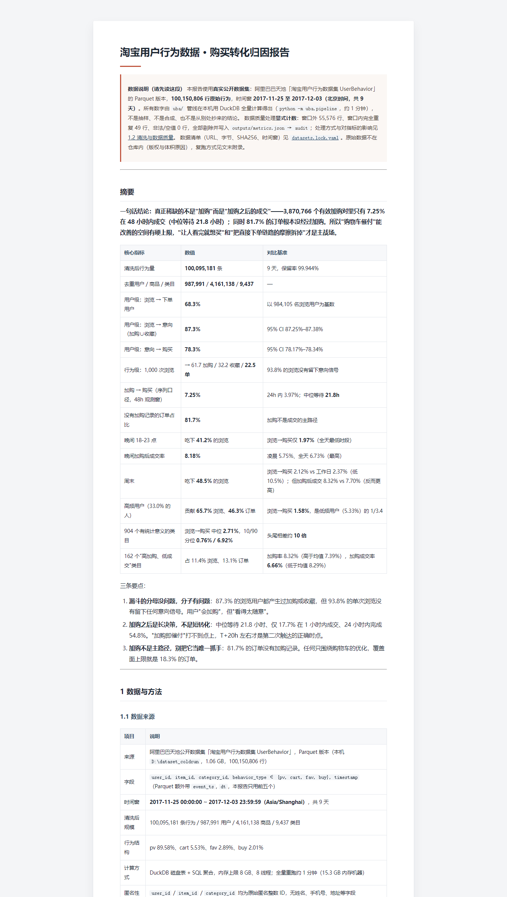
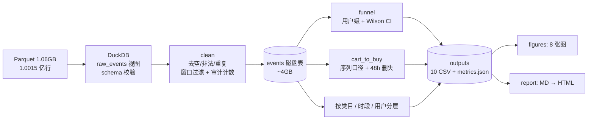

# 淘宝用户行为数据 · 购买转化归因分析

**一句话：用 1 亿行真实淘宝行为日志，把"看了却不买"拆成可执行的归因结论——一套 3 条命令跑通的 DuckDB 管线，从原始 Parquet 产出漏斗、6 条带数字的结论、8 张图和一份 HTML 报告。**

[](report/attribution-report.html)

> ### 数据属性：真实公开数据集，全量计算
> 数据源为阿里巴巴天池「淘宝用户行为数据集 UserBehavior」（Parquet，**100,150,806 行 / 1.06 GB**），时间窗 **2017-11-25 ~ 2017-12-03（北京时间，9 天）**。本仓库**不含原始数据**（体积与版权原因），但字段、清洗规则、指标 SQL、随机种子（仅合成回退数据用）全部在仓库里，`python -m uba.pipeline` 可在约 1 分钟内重算出本报告全部数字。
> **数据质量没有悄悄处理**：窗口外 55,576 行、完全重复 49 行、非法/空值 0 行，全部显式计数并写入 `outputs/metrics.json → audit`；其中窗口外记录涉及 41,450 个用户，但只有 3 个用户在窗口内没有行为，对用户级分母影响 ≈ 0.0003%。详见[报告 §1.2](report/attribution-report.md#12-清洗与数据质量)与 [`datasets.lock.yaml`](datasets.lock.yaml)。

**一句话结论**：漏斗真正的缺口不在"没人加购"，而在"加购之后没人成交"——3,870,766 个有效加购对只有 **7.25%** 在 48h 内成交（中位等待 **21.8h**）；同时 **81.7% 的订单根本没走加购**，所以只做购物车催付的覆盖面上限只有 18.3% 的订单。

[完整报告](report/attribution-report.md) · [HTML 版](report/attribution-report.html) · [指标明细](outputs/) · [图表](figures/) · [架构说明](docs/architecture.md)

---

## 30 秒看懂：问题、做法、结果

| | |
|---|---|
| **业务痛点** | 只盯 PV/UV/GMV，回答不了"流失卡在哪一步、预算给谁、投在什么时段"。运营缺的不是数据，是**带数字的优先级**。 |
| **做法** | 用户级漏斗 + 序列口径的加购→购买 + 48h 删失校正 + 类目/时段/活跃分层归因；每个结论都配对比基准与置信区间。 |
| **结果** | 6 条可执行结论：意向密度是主瓶颈；加购后是长决策（T+20h 才是第二触点）；晚间拿量、白天拿效率；周末"流量红利、成交效率低但购物车兑现更好"；高频撑流量、低频撑效率；类目差异达 10 倍。 |

### 效果数据（全部来自 `outputs/metrics.json`，可逐项核对）

| 指标 | 数值 | 对比基准 |
|---|---|---|
| 清洗后行为量 | **100,095,181** 条 / 987,991 用户 / 4,161,138 商品 / 9,437 类目 | 9 天，保留率 99.944% |
| 用户级漏斗 | 浏览 → 意向 **87.3%** → 购买 **78.3%**（=68.3% 的浏览用户） | 95% CI 87.25–87.38 / 78.17–78.34 |
| 行为级：1,000 次浏览 | → 61.7 加购 / 32.2 收藏 / **22.5 单** | 93.8% 的浏览无意向信号 |
| 加购 → 购买（序列口径，48h 窗） | **7.25%**（24h 内 3.97%） | 中位 **21.8h**，24h 内完成 54.8% |
| 未加购直接下单 | **81.7%** 的订单 | 加购覆盖面上限 18.3% |
| 晚间 18-23 点 | **41.2%** 的浏览 | 浏览→购买 1.97%（全天最低时段）；加购后成交 **8.18%**（最高） |
| 周末 vs 工作日 | 周末 **48.5%** 浏览 | 转化 2.12% vs 2.37%（低 10.5%）；加购成交 8.32% vs 7.70%（反而高 8%） |
| 高频用户（33.0% 的人） | 贡献 **65.7%** 浏览、46.3% 订单 | 浏览→购买 **1.58%**，低频用户 5.33%（3.4 倍差） |
| 904 个有效类目 | 转化中位 **2.71%**，10/90 分位 0.76%/6.92% | 头尾差约 **10 倍** |
| 162 个高加购低成交类目 | 占 11.4% 浏览、13.1% 订单 | 加购率 8.32% vs 均值 7.39%，成交率 6.66% vs 8.29% |

## 六条归因结论（每条都有支撑数字）

| # | 结论 | 支撑 |
|---|---|---|
| 1 | **意向密度是主瓶颈，不是支付环节** | 87.3% 的浏览用户产生过加购/收藏，但 93.8% 的单次浏览没有留下意向信号 |
| 2 | **加购后是长决策，T+20h 才是第二触点** | 中位等待 21.8h；1h 内成交仅 17.7%，24h 内完成 54.8%；48h 成交率 7.25% |
| 3 | **加购不是主路径** | 81.7% 的订单没有加购记录，只优化购物车最多覆盖 18.3% 订单 |
| 4 | **晚间拿量、白天拿效率** | 晚间 41.2% 浏览但转化 1.97%；10 点 2.95% vs 23 点 1.79%（1.65 倍）；晚间加购成交 8.18% 最高 |
| 5 | **周末是流量红利，不是成交荒漠** | 48.5% 浏览、转化低 10.5%；但加购后成交 8.26%/8.37%（工作日 5.57%–7.77%） |
| 6 | **高频撑流量、低频撑效率** | 高频 65.7% 浏览 / 1.58% 转化；低频 9.1% 浏览 / 5.33% 转化，每单浏览数差 3.4 倍 |

## 架构



分层原则：`analysis` 只做 SQL 计算（不写文件、可单测）；`pipeline` 负责编排与落盘；`figures` / `report` 只消费 `outputs/`，不重新读原始数据——避免同一指标出现两个口径。详见 [docs/architecture.md](docs/architecture.md)。

## 快速启动（3 条命令）

```bash
git clone https://github.com/Jamorlant/userbehavior-attribution-report.git && cd userbehavior-attribution-report
pip install -r requirements.txt && cp .env.example .env   # 把 UBA_DATA_PATH 指向 taobao.parquet
make all                                                  # 指标 → 8 图 → HTML，1 亿行约 1 分钟
```

不想改 `.env` 也可以一条命令内联：

```bash
UBA_DATA_PATH=/path/to/taobao.parquet make all
```

**开箱冒烟（无需真实数据）**：仓库带一份 100 万行合成回退数据（schema 对齐、seed 固定），CI 与小样本验证用它：

```bash
pip install -r requirements.txt && make all   # 默认读 data/userbehavior.csv.gz
```

Windows 无 `make` 时等价命令：

```bash
python -m uba.pipeline   # → outputs/
python -m uba.figures    # → figures/
python -m uba.report     # → report/attribution-report.html
```

配置全部走环境变量（见 [`.env.example`](.env.example)）：`UBA_DATA_PATH`、`UBA_DUCKDB_MEMORY`、`UBA_DUCKDB_THREADS`、`UBA_CENSOR_WINDOW_HOURS` 等，换数据源不改代码。

## 目录结构

```text
uba/                    # 分析包（纯 Python + DuckDB，无重型框架）
├── config.py           # 路径/常量/算力参数，.env 可覆盖
├── db.py               # Parquet/CSV → DuckDB 表 events（清洗 + 审计）
├── analysis.py         # SQL 口径：漏斗、序列转化、类目/时段/分层
├── pipeline.py         # 编排 + 落盘 → outputs/
├── synthetic.py        # 合成回退数据（CI / 冒烟用，非报告结论来源）
├── figures.py          # 8 张图（标题数字来自 outputs，无硬编码）
├── report.py           # Markdown → 单文件 HTML
└── logging_utils.py    # 日志分级
tests/                  # 17 个单测：口径 / 清洗 / schema / 端到端
docs/architecture.md    # 分层、口径、取舍、验证策略（给面试官）
docs/preview.png        # 报告首屏截图
data/                   # 合成回退数据（100 万行，仅冒烟用）
outputs/                # 10 张指标表 + metrics.json（结论唯一来源）
figures/                # 报告图表
report/                 # 报告 md + html
.github/workflows/ci.yml# lint + format + test + build
datasets.lock.yaml      # 数据清单：哪份数据产出了哪份结论
Makefile · pyproject.toml · requirements*.txt · .env.example
```

## 技术选型理由（以及刻意不引入的东西）

| 选择 | 为什么 | 收益 / 代价 |
|---|---|---|
| **DuckDB 而非 pandas 全量读入** | 1 亿行 × 5 列进 pandas 默认 dtype 常驻 6 GB+，再做 groupby/merge 在 15 GB 机器上会 OOM；DuckDB 磁盘落表 + 列式聚合，内存峰值只与聚合结果有关 | 全量重跑约 1 分钟；代价是多一个依赖、SQL 不如 DataFrame 直观 |
| **DuckDB 而非 Spark** | 单机可处理 1 亿行；Spark 要集群/调参，复现门槛远高于收益 | 面试官 `pip install` 就能跑；代价是上限约在十亿行 |
| **matplotlib 静态图** | 输出确定、CI 可复现、图片可版本化 | 代价是不能交互；报告以 HTML/打印为主，够用 |
| **Markdown → 单文件 HTML** | 内容与样式分离，GitHub 直接预览 md | 比引入前端框架更轻 |
| **无调度 / 无数据库服务** | 一次性分析交付，不是数据产品 | 用 Airflow/dbt 属过度设计 |
| **YAML 数据清单** | 明确"哪份数据产出了哪份结论"，可审计 | 多一个文件，但避免"README 说真实数据、报告却是旧结论" |
| **合成数据只作 CI 回退** | CI 不能拉 1 GB 数据，用 100 万行同 schema 数据保证管线不断 | 明确标注"非报告结论来源"，不让合成数据冒充真实结论 |

工程化：依赖精确锁定、`.env.example`、`Makefile`、17 个单测、CI（ruff + format + pytest + 全流程构建）、PR 模板（[`.github/pull_request_template.md`](.github/pull_request_template.md)）。

## 方法可信度：四个容易做错的地方

1. **加购→购买用序列口径**：同一 `(user_id, item_id)` 上"加购之后是否购买"，而不是 `buy / cart`——后者把直接下单的订单算进分母，会虚高转化率（本数据中这类订单占 **81.7%**）。
2. **观测窗删失校正**：剔除距数据末尾不足 48h 的 **1,515,818** 个加购，否则末尾两天必被判为未转化，周末/末日指标被系统性压低。
3. **时段归因按"加购小时"**：下单延迟中位 21.8h，用下单时刻会把晚间订单错记到次日凌晨，得出"凌晨转化最高"的错误结论。
4. **首日不计入日趋势**：11-25 缺少前置加购记录，首日"加购→成交"结构性偏低。

以上口径均有对应单测（`tests/test_analysis.py`），CI 会跑 lint + format + 17 个测试 + 全流程构建。

## 从合成数据切换到真实数据：结论变化

早期版本用合成数据（schema 对齐、seed 固定）验证方法，接入真实数据后**结论按真实数据重写，没有为了连续性保留旧结论**。主要变化：

| 指标 | 合成数据版 | 真实数据版 | 变化解读 |
|---|---|---|---|
| 用户级 浏览→意向 | 64.8% | **87.3%** | 真实用户更"会加购"，意向不是用户级瓶颈 |
| 用户级 浏览→下单 | 27.6% | **68.3%** | 9 天窗口 + 高频人群，用户级转化远高于合成假设 |
| 加购→购买（48h） | 34.2% | **7.25%** | 由"水位正常"改为**最大瓶颈**，中位等待从 8.4h 变为 21.8h |
| 未加购直接下单 | 23.8% | **81.7%** | 加购从"主路径"降为"少数路径"，催付的覆盖面上限被大幅下修 |
| 晚间 18-23 点 | 47.5% 浏览、转化最高 | **41.2% 浏览、转化最低** | 结论反转：晚间是"拿量+加购兑现好"，不是"浏览最容易成交" |
| 周末 | 47.9% 浏览、转化低 28% | **48.5% 浏览、转化低 10.5%** | 方向保留、幅度大幅缩小；且加购成交率周末反而更高 |
| 类目头尾差 | ~2 倍 | **~10 倍** | 真实类目长尾更极端，类目分层价值更高 |
| 反直觉类目 | 成交率仅为均值 1/3 | **约为均值 80%** | 现象存在但温和得多 |

合成数据仍保留在 `data/`，只用于 CI 与小样本冒烟，并在 `datasets.lock.yaml` 里标注 `used_in_report: false`。

## 已知限制 / 后续计划

- **观测窗仅 9 天**（2017-11-25 ~ 12-03）：跨大促、跨周复购不可观测；长决策链路被 48h 观测窗截断（28.1% 的加购被删失）。
- **无金额维度**：原数据集不含价格/成交金额，只能做订单数归因，不能做 GMV 归因；引入金额后类目结论可能反转。
- **81.7% 订单无加购**：漏斗未覆盖"立即购买"链路的决策过程，需结算页/详情页埋点补充。
- **类目字段不一致**：4,161,138 个商品中 1,405 个挂多个 `category_id`（涉及 61,927 行，0.06%），类目级结论存在聚合噪声。
- **相关非因果**：晚间/周末差异可能是选择效应，需 A/B 或倾向得分匹配验证。
- **数据质量口径差异**：`datasets.lock.yaml` 记录"损坏时间戳 1,280 行"为上游脚本口径；本仓库按"年份≠2017"判定为 1,899 行（其中 1902/2037 仅 3 行），两者都落在 55,576 行窗口外记录内，处理一致。已在 lock 文件注明。
- **中文图表字体**：Linux 需 `fonts-noto-cjk`（CI 已安装），本地缺字体会显示方框。
- TODO(real-data-v2)：用 Olist / UCI Online Retail II 做跨数据集口径迁移验证；接入价格维度升级为 GMV 归因。

## 数据来源、脱敏与许可

- 数据集：阿里巴巴天池「淘宝用户行为数据集 UserBehavior」，Parquet 版本。URL、字节数、SHA256、行数、时间窗、质量统计见 [`datasets.lock.yaml`](datasets.lock.yaml)。遵循原数据集的使用条款，仅用于研究与作品展示。
- 仓库内**不含任何真实用户行为记录**（体积 + 版权）；`data/` 下的 100 万行文件是 `uba/synthetic.py` 生成的合成回退数据（seed=42），仅用于 CI 与冒烟。
- `user_id` / `item_id` / `category_id` 均为匿名整数 ID，不含姓名、手机号、邮箱、地址等个人身份信息，也不含真实企业或客户名称。
