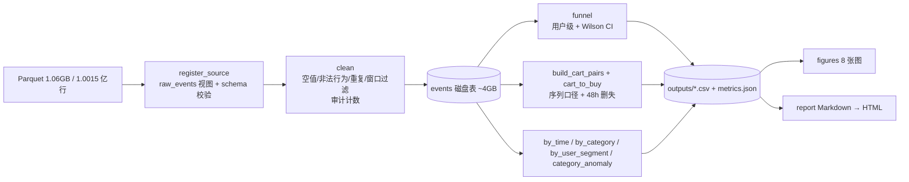

# 架构说明

面向技术面试官：解释"为什么这样拆、为什么这样算"，不重复 README 的使用说明。

## 1. 目标与非目标

| | 内容 |
|---|---|
| 目标 | 用一套可复跑的脚本，从原始行为日志产出漏斗、归因结论、图表与报告；换数据源不改代码 |
| 非目标 | 不做实时计算、不做在线服务、不引入调度系统——这是"一次性分析 + 可复现交付"的场景 |
| 规模 | 真实数据 100,150,806 行 / 1.06 GB Parquet；15.3 GB 内存机器上全量重跑约 1 分钟 |
| 约束 | 数据来源与质量处理必须显式披露；不硬编码路径/密钥/业务数字；不改变口径含义 |

## 2. 分层与依赖方向

```text
config ──► db ──► analysis ──► pipeline ──► outputs/ (10 csv + metrics.json)
  │                              │                 │
  │                              └── tests/        ├──► figures ──► figures/*.png
  └───────────────────────────────────────────────┴──► report  ──► report/*.html
```

| 模块 | 职责 | 为什么单独拆 |
|---|---|---|
| `uba/config.py` | 路径、常量、算力参数、环境变量 | 数据位置随机器变化，路径不能写死在业务代码里 |
| `uba/db.py` | Parquet/CSV → DuckDB 表 `events`，清洗 + 审计计数 | IO 与 SQL 方言集中在一处，换数据源只改这里 |
| `uba/analysis.py` | 纯计算：漏斗、序列转化、类目/时段/分层（只读 `events`） | 输入 DuckDB 连接、输出小 DataFrame/dict，测试可用几行小样本 |
| `uba/pipeline.py` | 编排 + 落盘 + 控制台摘要 | 把 IO 与计算分离，改一个指标不用动文件路径 |
| `uba/figures.py` | 读 `outputs/` 画图 | 图表只依赖指标表，不重新读原始数据，避免口径分叉 |
| `uba/report.py` | Markdown → 单文件 HTML | 报告是交付物，不是代码；模板与内容分离 |
| `uba/synthetic.py` | 合成回退数据（CI 用） | CI 拉不动 1 GB 数据；同 schema 小样本保证管线不断 |
| `uba/logging_utils.py` | 日志分级 | DEBUG 剔除明细 / INFO 里程碑 / WARNING 质量异常 / ERROR 中断 |

依赖方向单向：`analysis` 不 import `pipeline`；`figures` / `report` 不 import `analysis`。任何反向依赖都说明分层被破坏。

## 3. 数据流



**为什么用磁盘表而不是临时视图**：1 亿行事件表约 4 GB，后续 8 次聚合都读它。落成 DuckDB 磁盘表后，每次聚合从列式文件读所需列，内存峰值只与聚合结果有关；用临时视图会让每次查询重新解压 Parquet。

## 4. 五个关键口径（本项目的技术含量所在）

1. **加购→购买用序列口径**
   同一 `(user_id, item_id)` 上"加购之后是否购买"，而不是 `buy 总数 / cart 总数`。
   后者把"未加购直接下单"的订单算进分母，会虚高转化率——真实数据里这类订单占 **81.7%**。
   实现：`build_cart_pairs` 用 `min(timestamp)` 取首次加购、`LEFT JOIN` 首次购买，`converted = buy_ts >= cart_ts`。
   测试：`tests/test_analysis.py::test_cart_to_buy_sequence_and_censoring`（先买后加购不算、25h 不算 24h）。

2. **观测窗删失校正（48h）**
   距数据末尾不足 48h 的加购必然"还没机会转化"，剔除后再算成交率；否则末尾两天（周末）指标被系统性压低。
   删失数量写入 `metrics.json → cart2buy.censored_pairs`（真实数据：**1,515,818** 个，占 28.1%），可审计。
   阈值可配：`UBA_CENSOR_WINDOW_HOURS`。

3. **时段归因按"加购小时"**
   下单延迟中位 **21.8h**，用下单时刻会把晚间加购的成交错记到次日凌晨，得出"凌晨转化最高"的错误结论。
   实现：`cart_pairs.cart_ts` 转 `Asia/Shanghai` 后取 `hour` 分组，而不是 `buy_ts`。

4. **窗口外与损坏时间戳显式剔除**
   原始数据混有窗口外记录（55,576 行，全部 pv，其中 11-24 单日 40,231 行）与年份异常时间戳（1,899 行，1902/2037 仅 3 行）。
   处理方式：按官方时间窗（`Asia/Shanghai`）过滤，**每一类都计数并写进 `audit`**，不静默删除。
   为什么不按 `min/max` 截断：极值会把区间拉成几十年，等于没截；按业务窗口判定才有意义。

5. **类目设 material 门槛**
   真实数据 9,437 个类目里大量只有几十次浏览，转化率波动极大。排名与散点只纳入 `pv >= 10,000 且 cart > 0` 的 904 个类目（覆盖 89.9% 浏览 / 80.7% 订单）；异常类目检测再加 `carted_pairs >= 500`。

## 5. 工程约束

- **类型标注**：公开函数全部标注输入输出；返回结构化 `dataclass`（`CartConversion` / `CategoryAnomaly`），避免裸 tuple。
- **错误必须显式**：缺文件 → `FileNotFoundError`（带下一步提示）；缺字段/空数据/缺行为类型 → `ValueError`；CLI 捕获 `duckdb.Error` 后返回退出码 2。
- **日志分级**：`DEBUG` 图表生成明细；`INFO` 里程碑与结论数字；`WARNING` 数据质量异常；`ERROR` 无法继续。格式统一走 `uba/logging_utils.py`。
- **零魔法数**：图表标题中的百分比全部从 `outputs/` 读取；报告里每个数字都能在 `metrics.json` 溯源。
- **配置外置**：`.env.example` 列出全部变量，`.env` 被 `.gitignore` 忽略；相对路径按仓库根目录解析；已存在的环境变量优先于 `.env`（CI 覆盖不被覆盖）。
- **SQL 集中在 `db.py` / `analysis.py`**：不在 `pipeline` 里写业务 SQL，避免口径散落。

## 6. 设计取舍

| 选择 | 理由 | 被否决的方案 |
|---|---|---|
| DuckDB 磁盘表 | 1 亿行 pandas 默认 dtype 常驻 6 GB+，groupby/merge 在 15 GB 机器易 OOM；DuckDB 内存峰值只与聚合结果有关 | pandas 全量读入 / 分块手写聚合：代码量翻倍且易错 |
| 单机 DuckDB 而非 Spark | 1 亿行单机一分钟；Spark 需要集群/调参，复现门槛远高于收益 | Spark / Hive：对 1 亿行属于过度设计 |
| matplotlib 静态图 | 结果确定性高，CI 可复现，图片可 diff | ECharts / Plotly：需要额外渲染步骤，图片不可 diff |
| Markdown → 单文件 HTML | 内容与样式分离，GitHub 可直接预览 md，HTML 可打印 | 前端框架建站：对一份报告过重 |
| 不做调度/数仓分层 | 一次性分析，交付物是报告而不是数据产品 | Airflow / dbt：维护成本高于收益 |
| YAML 数据清单 | 明确"哪份数据产出了哪份结论" | README 只写一句"用了某数据集"：无法核对 |
| 合成数据仅作 CI 回退 | CI 不拉 1 GB 数据；同 schema 小样本保证管线不断 | 把合成数据当结论来源：会造成"数据声明与结论"失真 |

## 7. 验证策略

| 层次 | 手段 | 覆盖 |
|---|---|---|
| 口径 | `pytest` + 内存 DuckDB 小样本 | 漏斗人数、序列转化、24h 窗口、删失、去重/窗口外/损坏时间戳/空值计数、分层分位、异常类目、无转化 NaN |
| 契约 | `test_synthetic` | schema、行数可控、同 seed 可复现 |
| 编排 | `test_pipeline` | 小样本端到端落盘，10 张指标表 + `metrics.json` 齐全 |
| 报告 | `test_report` | Markdown 表格/代码块/图片真的渲染成 HTML；缺 md 时显式报错 |
| 回归 | 真实数据全量重跑后对照 `outputs/metrics.json` | 确认口径改动的影响面（本轮结论变化已写入 README） |
| CI | `.github/workflows/ci.yml` | ruff + format + pytest + 合成数据全流程构建（产物上传） |

## 8. 已知限制与下一步

- **9 天窗口**：跨大促/跨周复购不可观测；48h 观测窗会删失 28.1% 的加购。
- **无金额维度**：只能做订单数归因，不能做 GMV 归因。
- **81.7% 订单无加购**：漏斗覆盖不到"立即购买"链路，需要结算页/详情页埋点。
- **类目字段不一致**：1,405 个商品挂多个 `category_id`（61,927 行，0.06%），类目级聚合存在噪声。
- **相关非因果**：时段/星期差异可能是选择效应，验证需 A/B 或倾向得分匹配。
- **中文图表字体**：Linux CI 需 `fonts-noto-cjk`（workflow 已安装）；本地缺字体时中文显示为方框。
- TODO(real-data-v2)：Olist / UCI Online Retail II 跨数据集口径迁移验证；接入价格维度升级为 GMV 归因。
