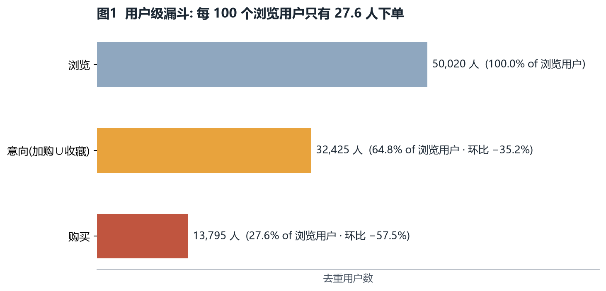
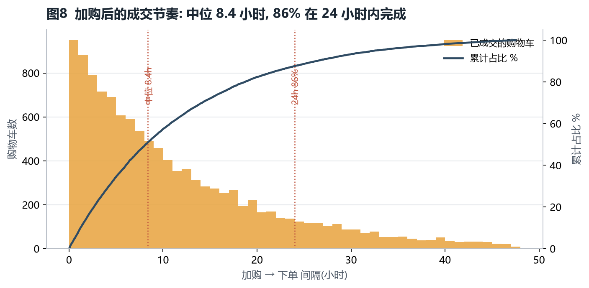
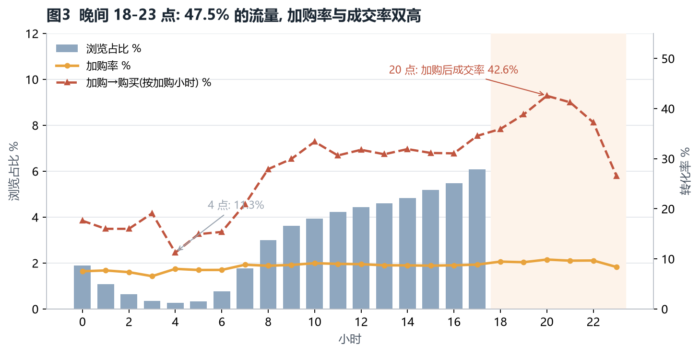
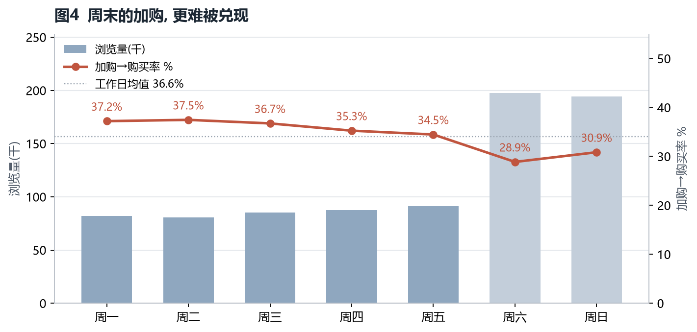
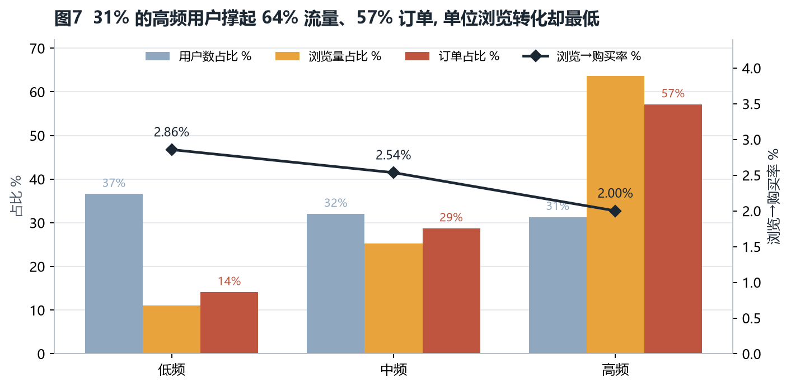
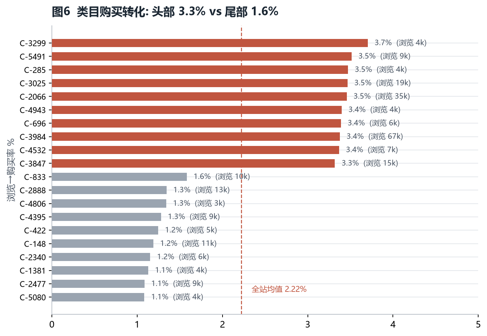
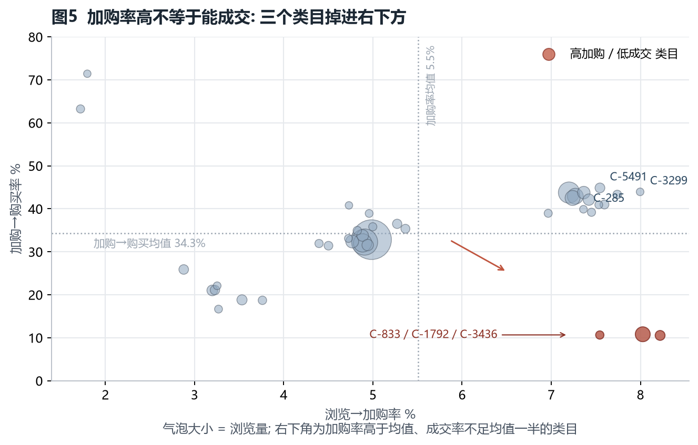

# 淘宝用户行为数据 · 购买转化归因报告

> **数据说明（请先读这段）**
> 本报告使用**合成数据集**，其字段与行为类型完全对齐阿里巴巴天池公开数据集「淘宝用户行为数据集 UserBehavior」（`user_id, item_id, category_id, behavior_type, timestamp`，时间窗同为 2017-11-25 至 2017-12-03）。生成规则、随机种子与复现命令见 [scripts/generate_data.py](../scripts/generate_data.py) 与「1.1 数据」。**下文所有数字均由脚本在真实计算中得出，但不等同于天猫/淘宝大盘结论**，属于"方法可迁移"的演示分析。

---

## 摘要

**一句话结论：漏斗最细的一环是"浏览→加购"（5.57%）而不是"加购→购买"（34.2%）。意向本身才是稀缺资源——90.9% 的浏览没有留下任何加购/收藏信号；把预算继续堆在拉新流量上，边际收益低于先做好"看完就加购"与"加购后 24h 内兑现"这两件事。**

| 核心指标 | 数值 | 对比基准 |
|---|---|---|
| 清洗后行为量 | 911,080 条 | 9 天（2017-11-25 ~ 12-03） |
| 去重用户 / 商品 / 类目 | 50,020 / 6,190 / 40 | — |
| 浏览用户 → 下单用户 | 27.6% | 每 100 个浏览用户有 72.4 人不买 |
| 浏览 → 意向（加购∪收藏，用户级） | 64.8% | 95% CI 64.4%–65.2% |
| 意向 → 购买 | 42.5% | 95% CI 42.0%–43.1% |
| 加购 → 购买（48h 观测窗） | 34.2% | 24h 内完成 86.1% 的转化 |
| 晚间 18-23 点加购率 | 9.49% | 全天最高，凌晨 7.55% |
| 周末浏览→购买 | 1.85% | 工作日 2.59%（低 28%） |
| 三个异常类目加购→购买 | 10.5%–10.8% | 40 类目均值 34.3% |

三条要点：

1. **漏斗的主流失口在"意向"环节**：1,000 次浏览只产生 90.7 个加购/收藏行为、22.3 笔订单，90.9% 的浏览行为没有产生任何意向信号。
2. **时间不是流量问题，而是兑现问题**：晚间拿到了 47.5% 的浏览，加购率与加购后成交率同时最高；周末拿到了 47.9% 的浏览，转化却比工作日低 28%。
3. **高活跃用户是流量引擎、不是转化引擎**：31.3% 的高频用户贡献 63.7% 浏览与 57.1% 订单，但浏览→购买率仅 2.00%，低于低频用户的 2.86%。

---

## 1 数据与方法

### 1.1 数据

| 项目 | 说明 |
|---|---|
| 来源 | **合成数据**（`scripts/generate_data.py`，seed=42）。天池原数据集下载需登录（返回 302 至登录页），GitHub 上的镜像文件仅数千行，不足以支撑类目级归因，故按公开数据集的统计特征建模 |
| Schema | `user_id, item_id, category_id, behavior_type ∈ {pv, cart, fav, buy}, timestamp` |
| 规模 | 911,080 条行为 / 50,020 用户 / 6,190 商品 / 40 类目 / 9 天 |
| 行为占比 | pv 89.85%，cart 5.00%，fav 3.14%，buy 2.00%（公开数据集常见量级为 89.6/5.5/3.3/2.0） |
| 建模要素 | 昼夜节律（22 点浏览峰值）、周末浏览抬升而成交走弱、类目长尾、用户活跃度与购买意图的负相关、加购后跨天犹豫（指数分布延迟） |
| 脱敏 | `user_id` 全部为随机整数，无任何个人身份字段；类目以 `C-xxx` 匿名编号指代，不出现任何真实企业/品牌名称 |

### 1.2 清洗

- 字段空值、非法 `behavior_type` 直接剔除；完全重复行去重 **392 行**，保留 911,080 行（剔除率 0.04%）。
- 时间窗截断到 2017-11-25 00:00 ~ 12-03 23:59。

### 1.3 指标口径（本报告最容易踩坑的部分）

| 指标 | 定义 | 为什么这样定义 |
|---|---|---|
| 用户级漏斗 | 去重用户数递进：浏览 → 加购∪收藏 → 购买 | 回答"有多少人走到了下一步"，避免同一用户多次浏览抬高分母 |
| 行为级转化率 | 目标行为次数 / pv 次数 | 反映单位流量的产出效率 |
| 加购→购买（序列口径） | 同一 `(user_id, item_id)` 上，加购之后是否出现购买 | 只有序列口径才能回答"加购了却没买" |
| 观测窗校正 | 只统计距数据集末尾 ≥48h 的购物车（删失 10,779 个） | 否则末尾两天的购物车会被系统性判为"未转化"，周末指标被压低 |
| 时段归因 | 按**加购发生的小时**统计成交率，而非按下单小时 | 下单延迟中位 8.4h，用下单时刻会把晚间订单错记到凌晨 |
| 首日剔除 | 11-25 不计入日趋势 | 前一天没有购物车，首日购买数系统性偏低（939 vs 常规 ~2,000） |

---

## 2 漏斗分析



**用户级**（50,020 名浏览用户为基数）：

| 环节 | 用户数 | 相对上一步 | 95% CI |
|---|---|---|---|
| 浏览 pv | 50,020 | — | — |
| 加购 cart | 25,319 | 50.6% | 50.2%–51.1% |
| 收藏 fav | 19,364 | 38.7% | 38.3%–39.1% |
| 意向（加购∪收藏） | 32,425 | 64.8% | 64.4%–65.2% |
| 购买 buy | 13,795 | **42.5%**（占意向） | 42.0%–43.1% |

**行为级**：1,000 次浏览 → 55.7 次加购、35.0 次收藏、22.3 次购买。

**加购之后发生了什么**（34,812 个有效购物车，48h 观测窗）：

- 整体成交率 **34.2%**，24h 内成交 **29.4%**；24h 内完成了全部转化的 **86.1%**。
- 延迟中位 **8.4 小时**，1 小时内成交仅 **8.0%**——"马上催付"性价比很低，真正的窗口是 T+2h 到 T+24h。
- **23.8% 的订单没有经过加购**（直接下单），说明加购不是唯一入口，但它是最大的一块"可干预库存"。



**流失点判断**：用户级 35.2% 的人停在"只看不加购"，行为级 90.9% 的浏览没有产生任何意向信号——**意向才是稀缺资源**。反过来，一旦产生了加购，34.2% 会在 48h 内成交，这个水位在零售场景里属于正常区间。所以优化重心应该是"让浏览更容易变成加购"，而不是"再把钱砸进漏斗顶部"。

---

## 3 归因发现

### 发现 1｜晚间 18-23 点：流量、加购率、成交率三重叠加



- 晚间 4 个时段占**额度最高的资源**：浏览 47.5%、加购量 22,919（占全部加购的一半以上）。
- 加购率 9.49%，比凌晨 0-6 点的 7.55% 高 **25.7%**（相对）。
- 关键在于**加购后的兑现率**：晚间加购的购物车成交率 **38.4%**，日间 31.2%，凌晨仅 **16.4%**。
- 单小时极值：20 点加购后成交率 **42.6%**，4 点仅 **11.3%**，相差 3.8 倍。

> 结论：同样一次加购，发生在晚间比发生在凌晨多 1 倍以上的成交概率。凌晨的加购是"想做但没条件做"的库存，不是无效流量。

### 发现 2｜周末：流量红利，成交荒漠



- 周末（4/9 天）拿走 **47.9% 的浏览**，但浏览→购买仅 **1.85%**，工作日 **2.59%**，低 **28%**。
- 按加购时段看成交率：周一至周五 34.5%–37.5%，**周六 28.9%、周日 30.9%**，整体比工作日低约 **20%**（29.9% vs 36.2%）。
- 周末的行为结构更"逛"：收藏率更高（意向行为更偏"先存着"），下单决策被推迟到工作日。

> 结论：周末不是"人少"，是"人来了不下单"。周末更适合做种草、加购激励与优惠券蓄水，把成交留到周一到周五兑现。

### 发现 3｜用户分层：高频用户撑流量，低频用户撑效率



| 分层 | 用户占比 | 浏览占比 | 订单占比 | 浏览→购买 | 每单所需浏览 |
|---|---|---|---|---|---|
| 低频（≤5 次浏览） | 36.6% | 11.0% | 14.1% | **2.86%** | 35.0 |
| 中频 | 32.1% | 25.3% | 28.7% | 2.54% | 39.4 |
| 高频 | 31.3% | **63.7%** | **57.1%** | **2.00%** | 50.0 |

- 高频用户贡献 63.7% 的浏览，却只换来 2.00% 的转化；低频用户用 1/6 的浏览换来 14.1% 的订单。
- 高频用户的 `浏览/单` 是低频用户的 **1.43 倍**——典型"逛得多、买得少"。

> 结论：用"浏览次数"当用户价值的代理指标会系统性高估高频用户。投放应面向"低频 + 有加购"的组合，而不是面向"最近很活跃"的人群包。

### 发现 4｜类目差异：头部 3.3%，尾部 1.6%



- 40 个类目浏览→购买率均值 2.22%，10 分位 1.19%，90 分位 3.46%，头部（3.3%–3.7%）与尾部（1.1%–1.6%）相差 **2 倍以上**。
- 类目占用的流量与产出严重不匹配：有的类目吃掉 5% 流量只贡献 2.6% 订单。

> 结论：类目是比"时段"更强的分层变量。同预算下，向高转化类目倾斜的边际订单增量更大。

### 发现 5（反直觉）｜三个类目"加购跑赢大盘，成交只有均值的 1/3"



| 类目 | 浏览 | 加购率 | 加购→购买 | 浏览→购买 |
|---|---|---|---|---|
| C-833 | 9,549 | **8.22%** | **10.54%** | 1.58% |
| C-1792 | 4,997 | **7.54%** | **10.64%** | 1.66% |
| C-3436 | 29,404 | **8.03%** | **10.81%** | 1.61% |
| 40 类目均值 | — | 5.51% | 34.30% | 2.22% |

- 加购率比均值高 **37%–49%**，但加购后的成交率只有均值的 **31%**。
- 三个类目合计吃掉 **5.4% 的浏览**，只产出 **3.9% 的订单**；累计 2,683 个加购，仅成交约 288 单。

**可能原因（需真实数据验证）**：

1. **比价/凑单型决策**——加购是"放进购物车比价、等满减"，成交被大促节奏截走（验证：看这几个类目加购后的跨类目行为，是否大量浏览同类竞品；看最终成交是否集中在促销日）。
2. **价格锚定失败**——加购率高说明商品页有吸引力（图/文案/低价引流款），但结算页的运费、起送门槛或规格加价把用户劝退（验证：加购→进入结算页的转化，以及取消订单原因）。
3. **规格/库存问题**——加购的是低价引流 SKU，实际可售的是高价 SKU（验证：按 SKU 粒度重算加购→成交）。

> 这是本报告最值得跟进的一条：它同时具备"流量大、加购意愿强、成交极差"三个特征，是最容易定位原因、也最容易见效的优化对象。

---

## 4 可执行建议

| # | 建议 | 依据 | 预期收益（本数据测算） |
|---|---|---|---|
| 1 | **把加购激励做成常驻机制**：加购后发"购物车专属券"，24h 未付再补一次提醒 | 加购→购买仅 34.2%，86.1% 的转化在 24h 内完成、中位 8.4h | 加购成交率每 +1pp ≈ +348 单（+1.9% 总订单）；首发触达建议 T+2h、二次 T+20h |
| 2 | **预算向晚间 18-23 点集中，凌晨降权** | 晚间加购率 9.49% / 加购后成交 38.4%；凌晨成交仅 16.4% | 每 1,000 个加购从凌晨迁到晚间，约多成交 220 单 |
| 3 | **周末改成"蓄水场"而非"收割场"**：周末主打加购返券、预约开售，成交动作引导至工作日 | 周末成交率 29.9% vs 工作日 36.2% | 周末成交率追平工作日 ≈ +703 单（+3.9% 总订单） |
| 4 | **定向优化 C-833 / C-1792 / C-3436**：先查结算页摩擦（运费门槛/规格/库存），再做满减凑单工具 | 三个类目 5.4% 流量、3.9% 订单，加购→成交仅 10.8% | 追平均值 ≈ +636 单（+3.5% 总订单） |
| 5 | **人群包从"高活跃"换成"低频+近期加购"** | 低频用户浏览→购买 2.86%，高频仅 2.00% | 同等曝光下的单位浏览订单效率提升约 43% |

优先级建议：**1 > 3 > 4 > 2 > 5**。建议 1 依赖现有的购物车数据即可上线，是零成本项；建议 3、4 需要跨部门协同（营销节奏、商品/结算页）。

---

## 5 局限与下一步

1. **数据是合成的，不是真实淘宝行为**。结构、量级、趋势方向按公开数据集特征校准，但具体百分比不构成对真实大盘的判断。所有结论的正确用法是"方法可迁移"，而非"结论可直接抄"。
2. **没有金额维度**。`UserBehavior` 原始数据没有价格与成交金额，因此本报告只能做"订单数"归因，无法做 GMV 归因。若有金额，类目结论可能会反转（高加购低成交的类目可能是高客单、低毛利结构）。
3. **观测窗有限（9 天）**。加购→购买的观测窗只覆盖 48h 内的行为，跨大促周期的长决策链路被低估；首日与末日已做删失/剔除处理，但跨周复购无法观测。
4. **直接购买占比 23.8%**。这部分订单没有加购路径，漏斗并未覆盖它们的决策过程（多为"立即购买"入口）。
5. **相关不等于因果**。晚间转化更高，可能同时是"晚间上线的人本身意图更强"的选择效应。要证因果需要做时段 A/B 或倾向得分匹配。

**下一步**：① 用真实 UserBehavior 数据重跑（脚本已参数化，替换 `data/` 即可）；② 引入价格/优惠券维度，把订单归因升级为 GMV 归因；③ 对建议 1 做 30 天 A/B，验证"加购后 T+2h 触达"的真实增量。

---

## 附录：目录与复现

```
scripts/generate_data.py   合成数据（同 schema，seed=42）
scripts/analyze.py         清洗 + 漏斗 + 归因指标 → outputs/
scripts/make_figures.py    8 张图 → figures/
outputs/                   指标明细表 (csv) + metrics.json
figures/                   报告图表
report/                    本报告 (md / html)
```

```bash
pip install -r requirements.txt
python scripts/generate_data.py --rows 1000000 --out data/userbehavior.csv.gz
python scripts/analyze.py
python scripts/make_figures.py
python scripts/build_report.py    # 生成 report/attribution-report.html
```

图表清单：图1 用户漏斗｜图2 每日趋势｜图3 小时转化｜图4 星期转化｜图5 类目散点｜图6 类目排名｜图7 用户分层｜图8 加购成交节奏。
